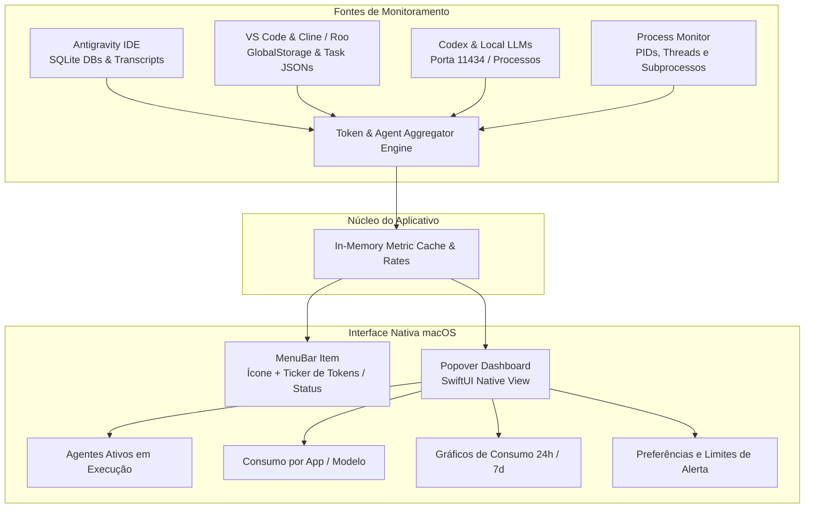

# Plano de Arquitetura e Implementação: Use Token Bar

**Use Token Bar** é um aplicativo nativo para a barra de menus do macOS (macOS Status Bar / MenuBarExtra), projetado para monitorar em tempo real o consumo de tokens de inteligência artificial e a atividade de agentes autônomos em programas como **Antigravity IDE**, **Codex**, **VS Code** (GitHub Copilot, Cline, Roo Code), **Cursor** e **Ollama**.

---

## 1. Repositórios de Assets e Recursos Visuais para macOS (GitHub)

Para garantir uma interface que siga as diretrizes estéticas do macOS (**Apple Human Interface Guidelines - HIG**) com suporte a Retina, temas Claro/Escuro e ícones adaptativos para MenuBar:

| Repositório / Recurso | Descrição | Utilidade no Projeto |
| :--- | :--- | :--- |
| **[SFSafeSymbols](https://github.com/SFSafeSymbols/SFSafeSymbols)** | Framework Swift para acesso seguro com tipagem estática a mais de 5.000 símbolos do Apple SF Symbols. | Ícones nativos com animação de pulso e modos `.hierarchical` / `.palette` na MenuBar. |
| **[Apple Design Resources](https://developer.apple.com/design/resources/) / [taxvui/apple-design-resources](https://github.com/taxvui/apple-design-resources)** | Templates e guias de iconografia, métricas e layouts nativos da Apple. | Conformidade visual com macOS Sequoia / Sonoma (cantos arredondados, margens, tipografia San Francisco). |
| **[Lucide Icons](https://github.com/lucide-icons/lucide)** | Coleção de ícones vetoriais modernos e consistentes em SVG. | Ícones vetoriais de fornecedores de IA (OpenAI, Anthropic, Gemini, Ollama, Meta). |
| **[SketchyBar](https://github.com/FelixKratz/SketchyBar)** | Projeto de referência para componentes dinâmicos e customizáveis na Status Bar do macOS. | Padrões de renderização leve e micro-badges para métricas em tempo real. |
| **[macos-menubar-wireguard](https://github.com/aequitas/macos-menubar-wireguard)** | Estrutura de menubar minimalista e reativa em Swift/SwiftUI. | Padrões de arquitetura de `NSStatusItem` e controle de ciclo de vida. |

---

## 2. Escolha da Linguagem e Stack Tecnológica

### Linguagem Escolhida: **Swift 5.9+ / 6 (SwiftUI + AppKit)**

#### Por que Swift é a melhor opção para este projeto:
1. **Desempenho e Consumo Mínimo de Recursos**:
   - MenuBar apps devem ser imperceptíveis no uso de memória e bateria (< 25MB de RAM vs > 400MB de frameworks como Electron/Tauri).
   - Uso de CPU em segundo plano < 0.2%.
2. **Integração Nativa com o macOS**:
   - APIs de `MenuBarExtra` e `NSStatusItem` permitem animações fluidas, popovers nativos e reatividade com o sistema.
   - Suporte nativo ao **SF Symbols** com renderização dinâmica de cores variáveis (`variableColor`) e modos de destaque.
   - Integração com `SMAppService` para inicialização automática com o sistema ("Launch at Login").
3. **Monitoramento de Baixo Nível no macOS**:
   - Acesso direto a `FSEventStream` / `DispatchSourceFileSystemObject` para observar alterações em arquivos de logs sem polling pesado.
   - Leitura direta de SQLite (`libsqlite3`) para inspecionar os bancos de conversação locais do Antigravity (`~/.gemini/antigravity-ide/conversations/*.db`).
   - Monitoramento do subsistema de processos do BSD/Darwin (`sysctl` / `NSRunningApplication`) para identificar agentes ativos.

---

## 3. Arquitetura do Sistema



---

## 4. Módulos e Componentes

### 4.1. MenuBar Status Controller (`MenuBarExtra` / `NSStatusItem`)
- **Modo Compacto**: Apenas o ícone estilizado com indicador de status (Verde: gerando tokens, Amarelo: ferramenta executando/esperando, Cinza: ocioso).
- **Modo Ticker**: Exibição do contador dinâmico (ex: `✨ 14.8k` ou `🤖 2 ativos`).
- Animação de pulso discreta ao detectar fluxo contínuo de tokens de saída.

### 4.2. Motores de Monitoramento (Watchers)
1. **AntigravityWatcher**:
   - Monitora `~/.gemini/antigravity-ide/conversations/*.db` e `~/.gemini/antigravity-ide/brain/*/logs/transcript.jsonl`.
   - Extrai número de passos, subtrajetórias de subagentes e tamanho de contexto.
2. **VSCodeWatcher**:
   - Monitora `~/Library/Application Support/Code/User/globalStorage/` (incluindo extensões como Cline, Roo Code e Copilot).
   - Coleta tokens de entrada (in), saída (out), cache (reads/writes) e estimativa de custo.
3. **LocalAIService (Ollama / Codex / LLMs)**:
   - Checa endpoints locais (`http://localhost:11434`) e processos ativos via `sysctl`.

### 4.3. Popover Dashboard (SwiftUI)
- **Status Geral**: Total de tokens na sessão e nas últimas 24 horas.
- **Lista de Agentes Ativos**: Cartões interativos com nome do agente, ferramenta em execução, tempo decorrido e memória.
- **Gráficos em Tempo Real**: `Charts` do SwiftUI exibindo taxa de tokens/minuto e divisão por fornecedor.
- **Ações Rápidas**: Interromper tarefa em segundo plano, zerar contador da sessão, abrir pasta de logs.

---

## 5. Estrutura de Arquivos do Projeto

```
Use Token Bar/
├── Package.swift                    # Configuração SPM (Swift Package Manager)
├── README.md                        # Documentação completa e instruções de compilação
├── PLAN.md                          # Plano técnico e arquitetural
├── Sources/
│   └── UseTokenBar/
│       ├── App/
│       │   ├── UseTokenBarApp.swift # Ponto de entrada @main do app macOS
│       │   └── AppDelegate.swift    # Gerenciamento de NSStatusItem e popover
│       ├── Models/
│       │   ├── AgentModel.swift     # Representação de um agente ativo
│       │   ├── TokenStats.swift     # Métricas de tokens e custos
│       │   └── AIAppProvider.swift  # Provedores suportados (Antigravity, Codex, etc.)
│       ├── Services/
│       │   ├── ProcessMonitor.swift # Detecção de processos do sistema
│       │   ├── AntigravityWatcher.swift # Leitura dos bancos e transcripts
│       │   ├── VSCodeWatcher.swift  # Leitura de dados do VS Code / Cline
│       │   └── TokenAggregator.swift# Consolidação e cálculo de taxas
│       └── Views/
│           ├── MenuBarIconView.swift # Renderização dinâmica na Status Bar
│           ├── DashboardView.swift   # Visualização principal do popover
│           ├── AgentRowView.swift    # Componente de linha para agente ativo
│           └── StatsChartView.swift  # Gráficos de consumo com SwiftUI Charts
└── Tests/
    └── UseTokenBarTests/
        └── TokenAggregatorTests.swift
```

---

## 6. Fases de Implementação

1. **Fase 1 (Estrutura e Fundação)**: Inicialização do repositório Git, repositório GitHub (`use-token-bar`), estrutura Swift Package Manager e documentação.
2. **Fase 2 (UI da MenuBar & Popover)**: Criação do `MenuBarExtra`, renderização dinâmica de SF Symbols, layout SwiftUI com cartões de estatísticas e lista de agentes.
3. **Fase 3 (Watchers de Agentes)**: Implementação do monitor de processos e do leitor de logs para Antigravity e extensões do VS Code.
4. **Fase 4 (Polimento e Recursos Avançados)**: Gráficos com SwiftUI Charts, alertas configuráveis de consumo de tokens e inicialização com o sistema.
