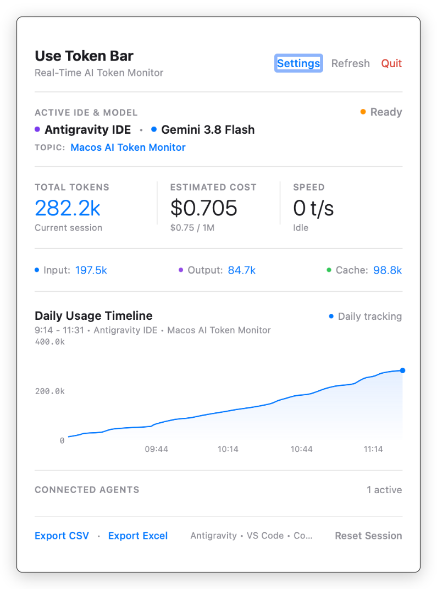
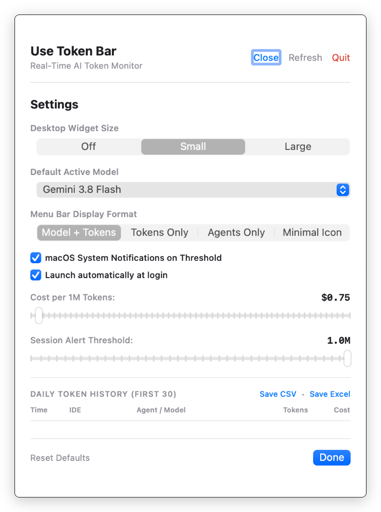

<div align="center">
  
  <h1>Use Token Bar</h1>
  <p><strong>Native, lightweight, real-time macOS menu bar monitor tracking AI developer tools and token consumption.</strong></p>

  <p>
    <a href="https://github.com/viniroque3/use-token-bar/releases/tag/v0.1"></a>
    
    
    
    
    
    
  </p>

  <p>
    <a href="https://github.com/viniroque3/use-token-bar/releases/download/v0.1/UseTokenBar-v0.1.dmg">
      
    </a>
  </p>
</div>

---

<div align="center">
  
  &nbsp;&nbsp;&nbsp;&nbsp;
  
  <p><em>Use Token Bar in action: Real-Time Token Monitor, Daily History, Desktop Widgets, and Settings</em></p>
</div>

---

## ⚡ Key Features

- **Native Menu Bar Integration**: Operates silently as an ultra-lightweight `LSUIElement` daemon without occupying Dock space.
- **Dynamic Real-Time Model Detection**: Automatically detects the active model currently in use (e.g., `Gemini 3.8 Flash`, `Claude 3.5 Sonnet`, `GPT-4o`, `Llama 3.3`) without requiring manual selection.
- **Smart Active IDE Detection**: Monitors foreground editors, prioritizing active AI coding agents (`Antigravity IDE`, `Cursor`, `VS Code`, `Ollama`).
- **Real-Time Throughput & Metrics**: Tracks input tokens, output tokens, cache hits, streaming speed (`t/s`), and estimated cost.
- **Continuous Daily Usage Timeline**: Dynamic chart visualizing token consumption from the start of the day (`09:14`) to the current moment.
- **Floating Desktop Widgets**:
  - **Small (200x145)**: Essential metrics with fine-line rounded typography in Apple Blue.
  - **Large (380x285)**: Comprehensive overview with vector mini-chart, clean spacing, and model breakdown.
- **Daily Token History (First 30 Records)**: Records the first 30 events of the day with timestamp, IDE, agent, model, tokens, and estimated cost.
- **Instant Excel & CSV Export**:
  - **Excel (`.xls`)**: Formatted spreadsheet with structured XML schema headers and totals.
  - **CSV (UTF-8 with BOM)**: Out-of-the-box compatibility with Microsoft Excel, Numbers, and Google Sheets.
  - **Safe SQLite Persistence**: Zero-lock read-only access (`sqlite3_busy_timeout`) preventing write blocking during compaction and live executions.
- **System Notifications & Launch at Login**: Native alerts when exceeding session token thresholds and macOS startup support via `SMAppService`.

---

## 📥 Installation & macOS Gatekeeper

### Method 1: Disk Image `.DMG` (Recommended)

1. Download the official installer: [**UseTokenBar-v0.1.dmg**](https://github.com/viniroque3/use-token-bar/releases/download/v0.1/UseTokenBar-v0.1.dmg).
2. Double-click the downloaded `.dmg` and drag **Use Token Bar** into your **Applications** folder.

#### ⚠️ How to Bypass macOS Gatekeeper Security Notice

As an independent open-source project distributed outside the Mac App Store (without a paid Apple Developer certificate), macOS Gatekeeper may display:
> *"The app cannot be opened because the developer cannot be verified"* or *"The app is damaged and can't be opened"*.

To open the application, use **one** of the options below:

##### Option 1: Terminal (Fastest - 1 Command)
Open **Terminal** and run:
```bash
xattr -cr "/Applications/Use Token Bar.app"
```
*This removes the quarantine attribute assigned by macOS to downloaded files.*

##### Option 2: Finder Context Menu
1. Open **Finder** and navigate to `/Applications`.
2. Right-click (or `Control + click`) on **Use Token Bar**.
3. Click **Open**.
4. In the confirmation dialog, click **Open**.

##### Option 3: System Settings
1. Open **System Settings**.
2. Go to **Privacy & Security**.
3. Scroll down to the **Security** section where you will see: *"Use Token Bar was blocked from opening..."*.
4. Click **Open Anyway** and confirm with your password or Touch ID.

---

### Method 2: Automatic Terminal Installation (Build from Source)

If you prefer building from source:

```bash
git clone https://github.com/viniroque3/use-token-bar.git
cd use-token-bar
make install
```

The installer will build the release binary, install the `.app` into `/Applications`, and register the `use-token-bar` CLI command in your Terminal.

---

## 🛠 Monitored Environments

| Environment / Tool | Inspection Method | Tracked Metrics |
| :--- | :--- | :--- |
| **Antigravity IDE** | Native Darwin SQLite3 (`conversations/*.db`) | Step payloads, conversation topics, compactions |
| **VS Code (Copilot / Cline / Roo)** | Local Extension Storage & Task JSON | Input/output tokens, cache hits, estimated cost |
| **Cursor & Codex CLI** | POSIX Process Table & Workspaces | Lifecycle detection and active agent status |
| **Ollama / Local LLMs** | Async REST Polling (`localhost:11434`) | Loaded models and local telemetry |

---

## 💻 CLI Commands

You can also manage Use Token Bar directly from the terminal:

```bash
# Launch the application in the Menu Bar
use-token-bar

# Check running process status
use-token-bar status

# Terminate gracefully
use-token-bar stop
```

---

## 🔒 Security & Privacy Guarantee

- **100% Local**: No token counts, code snippets, or metrics are sent over the network.
- **Read-Only**: File access is strictly read-only (`SQLITE_OPEN_READONLY | SQLITE_OPEN_NOMUTEX`).
- **Open Source**: Full transparency under the MIT License.

---

## 📄 License

Distributed under the MIT License. See [LICENSE](LICENSE) for details.
